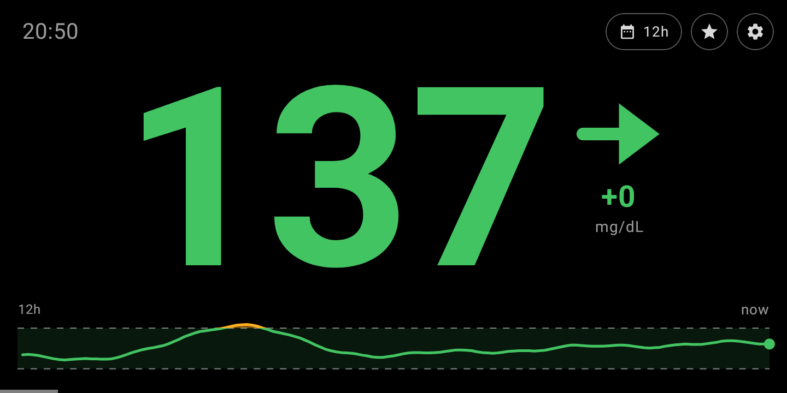

# GlucoDisplay

Turn a spare Android phone into an always-on display for your FreeStyle Libre glucose readings.
Put it on a stand next to your desk, TV or bed and see your latest value, trend arrow and graph at a
glance, with a dimmed night mode.

  
  

Sample data · Datos de ejemplo

*[En español más abajo](#en-español).*

> **Not a medical device.** Don't use it for treatment or insulin decisions. Readings can be late,
> missing or wrong: keep your sensor alarms on in the official LibreLink / LibreLinkUp apps.
> GlucoDisplay is free, independent and not affiliated with Abbott, and it may stop working at any
> time. You use it at your own risk. See the [licence](LICENSE).

## What you need

- An Android phone with Android 8 or newer, on a charger. An old phone is perfect.
- A **LibreLinkUp** account that can see the sensor: the person wearing it invites you from the
  LibreLink app, or you invite yourself with a second email.

## Just want to look first?

No account needed: tap **Try it** on the second page of the guide, or **Try the demo** on the sign-in
screen. The demo shows made-up readings, not real data, with a violet frame around the screen. Tap
the violet **Demo** pill when you're ready to sign in; your settings are kept.

## Install

1. Open the [latest release](../../releases/latest) on the phone and download the `.apk` file.
2. Open it. Android asks you to allow installing apps from your browser: allow it.
3. **Google Play Protect** may say it doesn't know the app, because it isn't from the Play Store.
   Tap **More details → Install without scanning** (or **Scan app** to let Google check it first).
4. Open GlucoDisplay, read the notice and follow the short guide to sign in with your LibreLinkUp
   email and password.
5. Allow what it asks for next: **Display over other apps** (so the display comes back by itself
   after a restart, a power cut or an update), **notifications** and **no battery restrictions**.

### About the Google Play Protect warning

Since version 1.0.0, if you choose **Scan app**, Google Play Protect may say the app could be harmful
("potentially unwanted"). We believe this is a false positive: GlucoDisplay only reads your own glucose
data from LibreLinkUp, has no ads or tracking, and its on-device scan comes back clean. The warning is
likely triggered by the permissions an always-on display needs (showing over other apps, starting at
boot) and by the app updating itself. We've asked Google to review it.

You can tap **More details → Install without scanning**, or wait until the review is resolved. If you're
unsure, waiting is fine.

## Updates

GlucoDisplay checks this page once a day. When there is a new version, a blue **Update** pill
appears on the display: tap it, then confirm. Your account, settings and history are kept. The
first time, Android asks you to allow GlucoDisplay to install apps; the update then carries on by
itself. If you leave the app while it downloads, a notification lets you finish the update.

## Privacy

Your LibreLinkUp email and password stay on your phone and are only sent to LibreLinkUp. Readings
and settings stay on your phone. No ads, analytics or tracking.

## Feedback and requests

Found a problem, or have an idea or request? [Open an issue](../../issues/new) on this repository.
Issues are public: never include your email, password or glucose readings.

---

## En español

Convierte un móvil Android que no uses en una pantalla siempre encendida con tus lecturas de glucosa
del FreeStyle Libre. Ponlo junto al escritorio, la tele o la cama y verás tu último valor, la
flecha de tendencia y la gráfica de un vistazo, con un modo noche atenuado.

> **No es un dispositivo médico.** No lo uses para decidir tratamientos ni dosis de insulina. Las
> lecturas pueden llegar tarde, faltar o ser incorrectas: mantén activadas las alarmas del sensor en
> las apps oficiales LibreLink / LibreLinkUp. GlucoDisplay es gratuita, independiente y no está
> vinculada a Abbott, y puede dejar de funcionar en cualquier momento. La usas bajo tu
> responsabilidad. Consulta la [licencia](LICENSE) (en inglés).

### Qué necesitas

- Un móvil con Android 8 o superior, enchufado. Un móvil antiguo es perfecto.
- Una cuenta de **LibreLinkUp** que vea el sensor: quien lo lleva te invita desde la app LibreLink,
  o te invitas tú mismo con un segundo email.

### ¿Quieres verla antes?

No necesitas cuenta: toca **Probar** en la segunda página de la guía, o **Probar la demo** en la
pantalla de inicio de sesión. La demo muestra lecturas inventadas, no datos reales, con un marco
violeta alrededor de la pantalla. Cuando quieras, toca la pastilla violeta **Demo** para iniciar
sesión; se mantienen tus ajustes.

### Instalación

1. Abre la [última versión](../../releases/latest) en el móvil y descarga el archivo `.apk`.
2. Ábrelo. Android te pedirá permitir instalar apps desde el navegador: permítelo.
3. **Google Play Protect** puede decir que no conoce la app, porque no viene de Play Store. Toca
   **Más detalles → Instalar sin analizar** (o **Analizar app** para que Google la revise antes).
4. Abre GlucoDisplay, lee el aviso y sigue la guía para iniciar sesión con tu email y contraseña
   de LibreLinkUp.
5. Permite lo que pide a continuación: **Mostrar sobre otras apps** (para que la pantalla vuelva sola
   tras un reinicio, un corte de luz o una actualización), **notificaciones** y **sin restricciones de
   batería**.

### Sobre el aviso de Google Play Protect

Desde la versión 1.0.0, si eliges **Analizar app**, Google Play Protect puede decir que la app podría
ser dañina ("potencialmente no deseada"). Creemos que es un falso positivo: GlucoDisplay solo lee tus
propios datos de glucosa de LibreLinkUp, no tiene anuncios ni seguimiento y su análisis en el móvil sale
limpio. Es probable que el aviso lo provoquen los permisos que necesita una pantalla siempre encendida
(mostrar sobre otras apps, iniciarse al encender) y que la app se actualice sola. Hemos pedido a
Google que lo revise.

Puedes tocar **Más detalles → Instalar sin analizar**, o esperar a que se resuelva la revisión. Si tienes
dudas, esperar está bien.

### Actualizaciones

GlucoDisplay revisa esta página una vez al día. Cuando hay una versión nueva aparece una pastilla
azul **Actualizar** en la pantalla: tócala y confirma. Se mantienen tu cuenta, los ajustes y el
historial. La primera vez, Android te pedirá permitir que GlucoDisplay instale apps; después la
actualización sigue sola. Si sales de la app mientras se descarga, una notificación te permite terminarla.

### Privacidad

Tu email y contraseña de LibreLinkUp se quedan en tu móvil y solo se envían a LibreLinkUp. Las
lecturas y los ajustes se quedan en tu móvil. Sin anuncios, analíticas ni seguimiento.

### Comentarios y peticiones

¿Has encontrado un problema o tienes una idea o petición? [Abre un issue](../../issues/new) en este
repositorio. Los issues son públicos: no incluyas nunca tu email, tu contraseña ni tus lecturas de
glucosa.

---

FreeStyle Libre, LibreLink, LibreLinkUp and LibreView are trademarks of Abbott.
