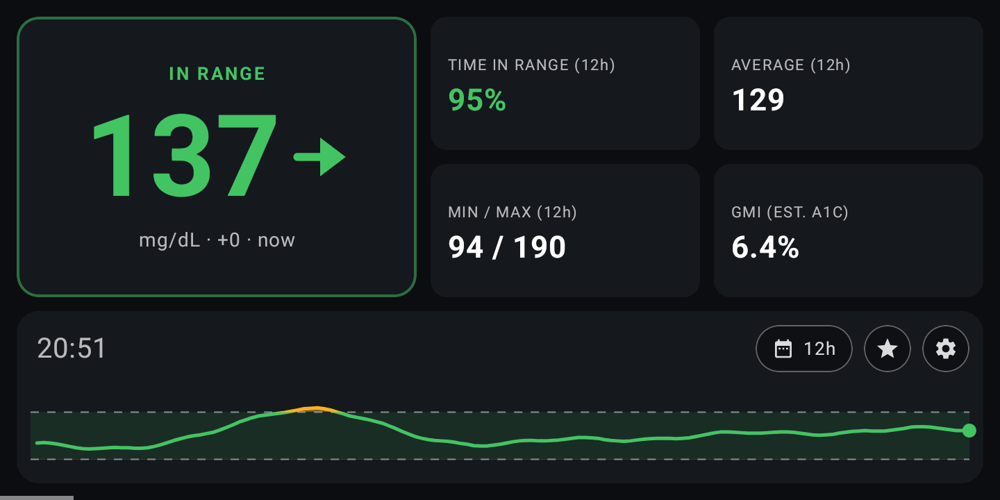

# GlucoDisplay

Turn a spare Android phone into an always-on display for your FreeStyle Libre glucose readings.
Put it on a stand next to your desk, TV or bed and see your latest value, trend arrow and graph at a
glance, with a dimmed night mode.

  
  

Sample data · Datos de ejemplo

*[En español más abajo](#en-español).*

> **Not a medical device.** Don't use it for treatment or insulin decisions. Readings can be late,
> missing or wrong: keep your sensor alarms on in the official LibreLink / LibreLinkUp apps.
> GlucoDisplay is free, independent and not affiliated with Abbott, and it may stop working at any
> time. You use it at your own risk. See the [licence](LICENSE).

## What you need

- An Android phone with Android 8 or newer, on a charger. An old phone is perfect.
- A **LibreLinkUp** account that can see the sensor: the person wearing it invites you from the
  LibreLink app, or you invite yourself with a second email.

## Install

1. Open the [latest release](../../releases/latest) on the phone and download the `.apk` file.
2. Open it. Android asks you to allow installing apps from your browser: allow it.
3. **Google Play Protect** may say it doesn't know the app, because it isn't from the Play Store.
   Tap **More details → Install without scanning** (or **Scan app** to let Google check it first).
4. Open GlucoDisplay, read the notice and follow the short guide to sign in with your LibreLinkUp
   email and password.

## Updates

GlucoDisplay checks this page once a day. When there is a new version, a blue **Update** pill
appears on the display: tap it, then confirm. Your account, settings and history are kept. The
first time, Android asks you to allow GlucoDisplay to install apps.

## Privacy

Your LibreLinkUp email and password stay on your phone and are only sent to LibreLinkUp. Readings
and settings stay on your phone. No ads, analytics or tracking.

---

## En español

Convierte un móvil Android que no uses en una pantalla siempre encendida con tus lecturas de glucosa
del FreeStyle Libre. Ponlo junto al escritorio, la tele o la cama y verás tu último valor, la
flecha de tendencia y la gráfica de un vistazo, con un modo noche atenuado.

> **No es un dispositivo médico.** No lo uses para decidir tratamientos ni dosis de insulina. Las
> lecturas pueden llegar tarde, faltar o ser incorrectas: mantén activadas las alarmas del sensor en
> las apps oficiales LibreLink / LibreLinkUp. GlucoDisplay es gratuita, independiente y no está
> vinculada a Abbott, y puede dejar de funcionar en cualquier momento. La usas bajo tu
> responsabilidad. Consulta la [licencia](LICENSE) (en inglés).

### Qué necesitas

- Un móvil con Android 8 o superior, enchufado. Un móvil antiguo es perfecto.
- Una cuenta de **LibreLinkUp** que vea el sensor: quien lo lleva te invita desde la app LibreLink,
  o te invitas tú mismo con un segundo email.

### Instalación

1. Abre la [última versión](../../releases/latest) en el móvil y descarga el archivo `.apk`.
2. Ábrelo. Android te pedirá permitir instalar apps desde el navegador: permítelo.
3. **Google Play Protect** puede decir que no conoce la app, porque no viene de Play Store. Toca
   **Más detalles → Instalar sin analizar** (o **Analizar app** para que Google la revise antes).
4. Abre GlucoDisplay, lee el aviso y sigue la guía para iniciar sesión con tu email y contraseña
   de LibreLinkUp.

### Actualizaciones

GlucoDisplay revisa esta página una vez al día. Cuando hay una versión nueva aparece una pastilla
azul **Actualizar** en la pantalla: tócala y confirma. Se mantienen tu cuenta, los ajustes y el
historial. La primera vez, Android te pedirá permitir que GlucoDisplay instale apps.

### Privacidad

Tu email y contraseña de LibreLinkUp se quedan en tu móvil y solo se envían a LibreLinkUp. Las
lecturas y los ajustes se quedan en tu móvil. Sin anuncios, analíticas ni seguimiento.

---

FreeStyle Libre, LibreLink, LibreLinkUp and LibreView are trademarks of Abbott.
